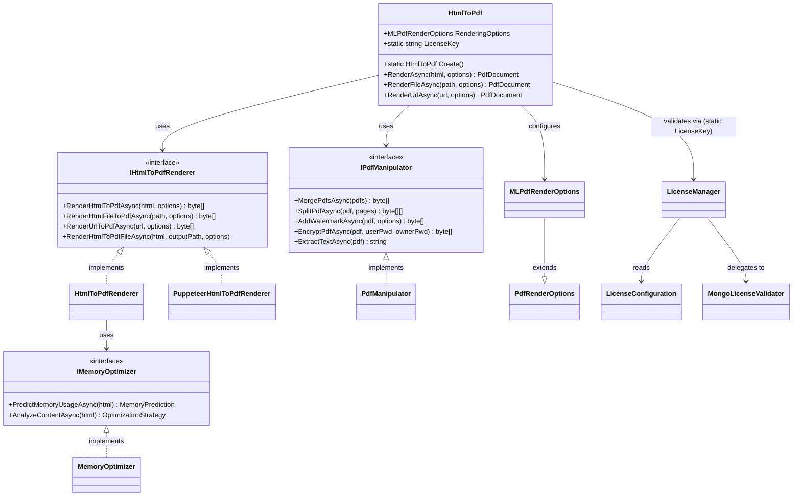
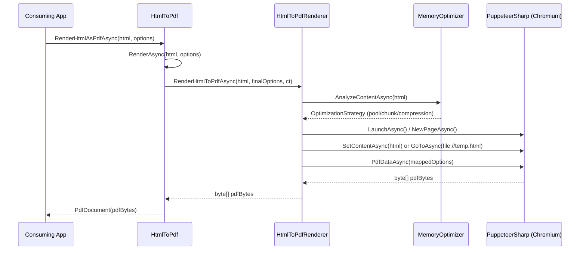
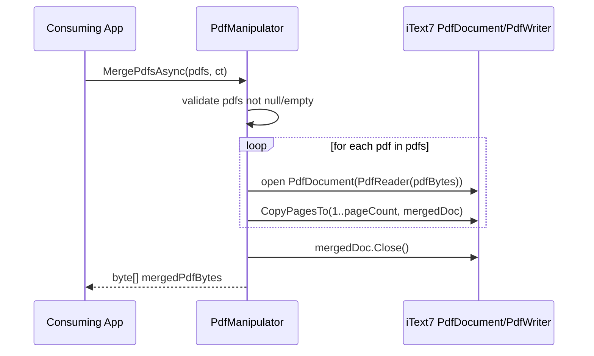
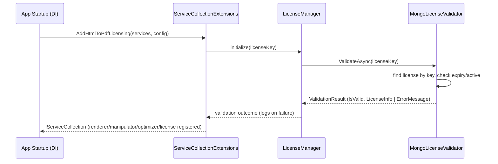

# HtmlToPdfCore — Architecture Overview

This document summarizes the architecture of the `HtmlToPdfCore` library: its components, their
responsibilities and dependencies, and the main workflows. It is intended as a quick-start reference
for developers who need to understand the codebase before making changes. (Generated as part of
SCRUM-27.)

## 1. High-level architecture

`HtmlToPdfCore` is a .NET library that converts HTML (strings, files or URLs) into PDF documents, and
provides post-processing (merge/split/watermark/encrypt/extract) on the resulting PDFs. It is organised
in layers:

- **Public API** — `HtmlToPdf` (root of the library, `HtmlToPdf.cs`): a facade that developers new up
  (`HtmlToPdf.Create()`), configure via `RenderingOptions` / `PrintOptions`, and call to render PDFs.
- **Rendering** — `Renderers/HtmlToPdfRenderer.cs` and `Renderers/PuppeteerHtmlToPdfRenderer.cs`
  implement `IHtmlToPdfRenderer` (`Interfaces/IHtmlToPdfRenderer.cs`). They drive a headless Chromium
  browser via PuppeteerSharp to turn HTML/URLs into PDF bytes.
- **PDF post-processing** — `Services/PdfManipulator.cs` implements `IPdfManipulator` and uses
  **iText7** to merge, split, watermark, encrypt and extract text from PDFs.
- **Memory/AI optimisation** — `AI/MemoryOptimizer.cs` implements `IMemoryOptimizer`. It inspects the
  HTML (size, image/CSS/table/font counts) and returns heuristics-based `MemoryPrediction` /
  `OptimizationStrategy` values (pool size, chunk size, compression level) used to tune rendering.
- **Options/models** — `Models/PdfRenderOptions.cs` defines `PdfRenderOptions` / `MLPdfRenderOptions`
  and supporting types (page size, margins, header/footer, watermark, measurement units, etc.) that
  configure every render call.
- **Licensing** — `Licensing/LicenseManager.cs`, `LicenseConfiguration.cs` and
  `MongoLicenseValidator.cs` validate a license key (optionally against MongoDB) before/while the
  library is used, and are wired up through `Extensions/ServiceCollectionExtensions.cs` for apps using
  `Microsoft.Extensions.DependencyInjection`.
- **DI integration** — `Extensions/ServiceCollectionExtensions.cs` registers the renderer, manipulator,
  memory optimizer and license services with an `IServiceCollection`, for ASP.NET Core / generic host
  consumers.

### Dependencies between components

- `HtmlToPdf` depends on `IHtmlToPdfRenderer`, `IPdfManipulator` and (indirectly, via
  `HtmlToPdfRenderer`) `IMemoryOptimizer`.
- `HtmlToPdfRenderer` / `PuppeteerHtmlToPdfRenderer` depend on `PdfRenderOptions` and PuppeteerSharp;
  they consult `IMemoryOptimizer` to size browser/page resources before rendering.
- `PdfManipulator` depends only on `Models` (e.g. `WatermarkOptions`) and iText7 — it has no
  dependency on the renderer, so PDF post-processing can be used independently of HTML rendering.
- `Licensing` classes are independent of rendering/manipulation; `ServiceCollectionExtensions` is the
  only place that wires licensing into the DI container alongside the renderer/manipulator.

## 2. Component diagram (UML class diagram)

## 3. Sequence diagrams (key workflows)

### 3.1 Render HTML string to PDF (`HtmlToPdf.RenderHtmlAsPdfAsync`)

### 3.2 Merge PDFs (`PdfManipulator.MergePdfsAsync`)

### 3.3 License validation at startup (`AddHtmlToPdfLicensing` / `LicenseManager`)

## 4. Findings summary

- **Clear facade pattern**: `HtmlToPdf` keeps the public surface small (`Create`, `RenderAsync`,
  `RenderFileAsync`, `RenderUrlAsync`) while delegating actual work to interfaces
  (`IHtmlToPdfRenderer`, `IPdfManipulator`), which keeps consumers decoupled from PuppeteerSharp/iText7
  implementation details.
- **Two concerns, two libraries**: rendering (PuppeteerSharp/Chromium) and PDF post-processing
  (iText7) are cleanly separated into `Renderers/` and `Services/`, each behind its own interface in
  `Interfaces/IHtmlToPdfRenderer.cs`. This makes it possible to use `PdfManipulator` standalone, or to
  swap in `PuppeteerHtmlToPdfRenderer` vs `HtmlToPdfRenderer` without touching the facade.
- **Memory/AI optimisation is heuristic, not ML-trained**: despite being under `AI/`, `MemoryOptimizer`
  (`AI/MemoryOptimizer.cs:128` `PredictWithHeuristics`) uses rule-based heuristics over counted HTML
  features (image/table/CSS counts) rather than a trained model. This is worth knowing before extending
  it — "AI" here means heuristic content analysis, not a model artifact.
- **Licensing is decoupled from rendering**: `Licensing/*` only touches the rest of the system through
  `Extensions/ServiceCollectionExtensions.cs` and the static `HtmlToPdf.LicenseKey` property, so license
  changes are isolated.
- **Options-driven configuration**: nearly every rendering/formatting behaviour (page size, margins,
  header/footer, watermark text) flows through `Models/PdfRenderOptions.cs`, giving one place to look
  for all tunable behaviour.

## 5. Recommendations for future development

- When adding a new renderer backend, implement `IHtmlToPdfRenderer` (see
  `Interfaces/IHtmlToPdfRenderer.cs:11`) and register it via
  `Extensions/ServiceCollectionExtensions.cs` rather than modifying `HtmlToPdf` directly.
- When adding new PDF post-processing operations, extend `IPdfManipulator` and `PdfManipulator` — keep
  iText7 usage confined to `Services/`, matching the existing separation of concerns.
- Treat `AI/MemoryOptimizer.cs` as heuristic tuning logic; if a real ML model is introduced later,
  consider renaming/clarifying the "AI" naming or documenting the heuristic nature explicitly in code
  comments (it is already noted in `HtmlFeatures`/`PredictWithHeuristics`).
- Keep license validation logic (`Licensing/`) isolated from rendering/manipulation code paths so the
  core PDF features remain independently testable without a MongoDB dependency.
- Use this diagram set as a starting point; as new workflows (e.g. new `RenderAsync` overloads) are
  added, extend Section 3 with additional sequence diagrams rather than overloading existing ones.
