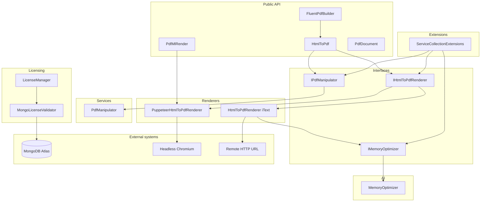
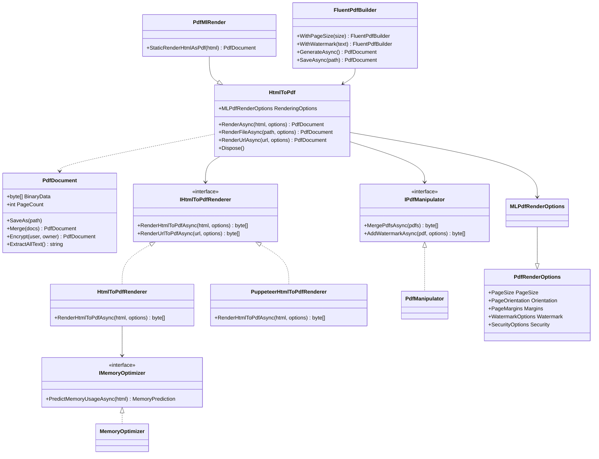
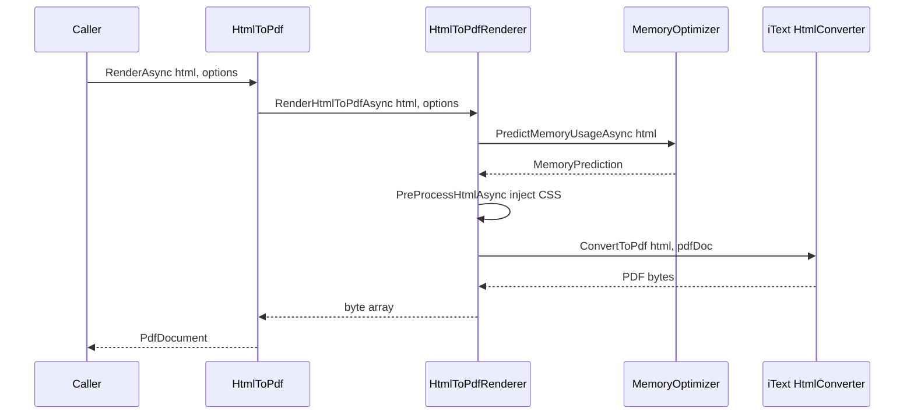
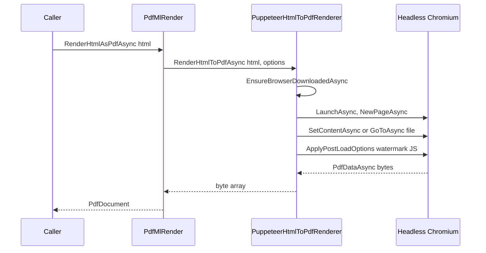
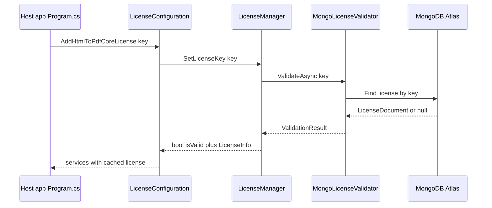
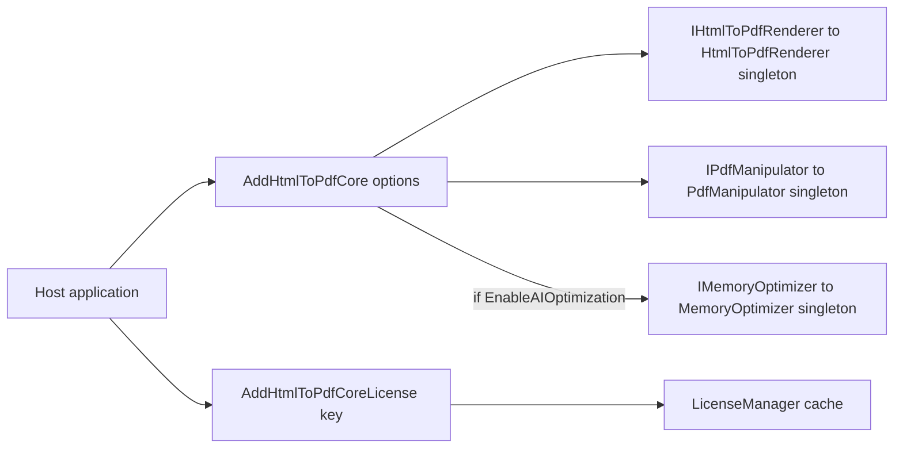

# Project analysis: SCRUM-28 - Generate Visual Architecture Documentation for Existing Project

_Generated by AI SprintFlow on 2026-10-21 from `RoyceLark/HtmlToPdfCore` at `ac5c802651`. No code was changed._

## Summary

HtmlToPdfCore (NuGet package id `Pdf.ML`) is a single-assembly .NET 8/9/10 class library that converts HTML to PDF and manipulates the resulting documents. It exposes a fluent public API (`HtmlToPdf`, `FluentPdfBuilder`, `PdfDocument`) backed by two pluggable rendering engines - a fast iText7-based renderer and a true-Chromium renderer via PuppeteerSharp - selected through the `IHtmlToPdfRenderer` abstraction. A small heuristic 'AI' module predicts memory needs before rendering, a `PdfManipulator` service handles merge/split/watermark/encrypt/extract-text, and a `Licensing` module validates license keys against a remote MongoDB Atlas database at startup. There is no HTTP host, controller layer or persistent application data store inside this repo; it is a library meant to be consumed by a host application (e.g. ASP.NET Core) via `AddHtmlToPdfCore()`. The main risks are a hardcoded MongoDB connection string in source, disabled license enforcement at render time, and two renderer code paths that must be kept behaviourally in sync.

## Architecture

This is a .NET library project (`HtmlToPdfCore.csproj`, multi-targeting net8.0/9.0/10.0), not a service with its own entry point - the entry point is whatever host application references the NuGet package `Pdf.ML` and calls its API. There is no web layer, no controllers and no persistent database owned by this repo.

**Public API layer** (`HtmlToPdf.cs`, 988 lines, root namespace `HtmlToPdfCore`): the facade class `HtmlToPdf` (implements `IDisposable`) wires together an `IHtmlToPdfRenderer` and an `IPdfManipulator`, exposes `RenderAsync`/`RenderFileAsync`/`RenderUrlAsync` plus many aliases (`RenderHtmlAsPdfAsync`, synchronous wrappers) for drop-in compatibility with other PDF libraries. `PdfMlRender` is a subclass that forces the Chromium (`PuppeteerHtmlToPdfRenderer`) engine - intended for 'IronPDF-parity' use. `FluentPdfBuilder` offers a chainable options builder (`WithPageSize`, `WithWatermark`, `WithSecurity`, etc.) that ultimately calls back into `HtmlToPdf`. `PdfDocument` wraps the resulting `byte[]`, offering `SaveAs`, `Merge`, `InsertPage`, `RemovePage`, `AddWatermark`, `Encrypt`, `ExtractAllText`, `StampHTML/Image` - i.e. result-object convenience methods that duplicate some of `IPdfManipulator`'s logic directly against iText APIs.

**Interfaces layer** (`Interfaces/IHtmlToPdfRenderer.cs`): defines three contracts - `IHtmlToPdfRenderer` (render HTML/file/URL to bytes), `IPdfManipulator` (merge/split/watermark/encrypt/extract text) and `IMemoryOptimizer` (predict memory, analyze content) - keeping the facade decoupled from concrete engines.

**Renderers layer** (`Renderers/`): `HtmlToPdfRenderer` (810 lines) is the default engine - it builds iText `ConverterProperties`, injects generated CSS for margins/background/grayscale/font-scale/zoom, throttles concurrency with a `SemaphoreSlim`, pools `MemoryStream`s via `ObjectPool`, optionally calls the memory optimizer first, then calls `iText.Html2pdf.HtmlConverter.ConvertToPdf`. It also has its own `HttpClient` to fetch URLs for `RenderUrlToPdfAsync`. `PuppeteerHtmlToPdfRenderer` (453 lines) launches a headless Chromium via PuppeteerSharp (auto-downloading the browser on first use), maps `PdfRenderOptions` to Puppeteer's `PdfOptions`, injects `<base>` tags and writes to temp files for `file://` content, and evaluates JS to draw watermarks and headers/footers. Both renderers implement the same `IHtmlToPdfRenderer` interface but are independent implementations with duplicated option-mapping logic.

**AI layer** (`AI/MemoryOptimizer.cs`): despite the 'AI/ML' branding and the `Microsoft.ML` package reference in the csproj, this is pure regex-based heuristics (counts ``, `<table>`, `
`, `<script>`, CSS length) feeding simple linear formulas to estimate memory (MB), recommended object-pool size, and a `CompressionLevel`. No trained ML.NET model is loaded.

**Services layer** (`Services/PdfManipulator.cs`): post-processing operations on existing PDF byte arrays using iText's `PdfDocument`/`PdfReader`/`PdfWriter`, `PdfCanvas`, `PdfTextExtractor` - merge, split by page numbers, watermark, AES-256 encryption, and text extraction.

**Licensing layer** (`Licensing/`): `LicenseConfiguration` offers `AddHtmlToPdfCoreLicense(IServiceCollection, ...)` DI extensions that validate a key at startup and print console banners. `LicenseManager` is a static, in-process singleton cache (24h TTL) that delegates to `MongoLicenseValidator`, which opens a direct `MongoClient` connection (hardcoded `mongodb+srv://` connection string embedded in source, `Licensing/LicenseManager.cs:15`) to a `licenses`/`activations` collection in an external MongoDB Atlas cluster. Notably, the actual license check inside the render path (`Renderers/HtmlToPdfRenderer.cs:75-82`) is commented out, so license validation currently only happens if a host app explicitly calls `AddHtmlToPdfCoreLicense` at startup - it is not enforced per render call.

**Extensions layer** (`Extensions/ServiceCollectionExtensions.cs`): `AddHtmlToPdfCore()` registers `IHtmlToPdfRenderer -> HtmlToPdfRenderer`, `IPdfManipulator -> PdfManipulator`, and conditionally `IMemoryOptimizer -> MemoryOptimizer`, all as singletons via `TryAddSingleton`, exposing `HtmlToPdfCoreOptions` (AI toggle, max concurrent renders, timeout).

**Models layer** (`Models/PdfRenderOptions.cs`, 582 lines): `PdfRenderOptions` is the large options bag (page size/orientation/margins, JS, timeouts, media type, header/footer, image quality, AI toggle, watermark, security, custom HTTP headers/cookies, etc.) with many alias properties (`PaperSize`, `PrintHtmlBackgrounds`, `WaitFor`...) for API-compatibility with other PDF libraries. `MLPdfRenderOptions` is an empty subclass used as the 'branded' options type on the public API. Supporting types: `PageMargins`, `HeaderFooterOptions`/`HtmlHeaderFooter`/`TextHeaderFooter`, `PdfMetadata`, `WatermarkOptions`, `SecurityOptions`, `MemoryPrediction`, `OptimizationStrategy`, and enums `PageSize`, `PageOrientation`, `CssMediaType`, `MeasurementUnit`, `WatermarkPosition`, `CompressionLevel`.

**External systems**: MongoDB Atlas (license store, `Licensing/MongoLicenseValidator.cs`), arbitrary remote HTTP(S) URLs fetched via `HttpClient` for `RenderUrlToPdfAsync` (`Renderers/HtmlToPdfRenderer.cs:335-386`), and a self-downloaded headless Chromium binary managed by PuppeteerSharp (`Renderers/PuppeteerHtmlToPdfRenderer.cs:30-48`).

**Tech stack:** .NET 8/9/10 (C# latest, nullable enabled) class library, iText 9.4.0 + itext.pdfhtml 6.3.0 + itext.bouncy-castle-adapter (PDF generation/manipulation/encryption), PuppeteerSharp 18.0.2 (headless Chromium rendering engine), Microsoft.ML 3.0.1 (referenced but unused - optimizer is heuristic, not an ML model), MongoDB.Driver 2.25.0 (remote license validation), Microsoft.Extensions.Logging/Configuration/ObjectPool/DependencyInjection (hosting integration), HtmlAgilityPack, AngleSharp, SixLabors.ImageSharp, System.Drawing.Common, BouncyCastle.Cryptography (HTML/image/crypto support), Packaged and distributed as the NuGet package 'Pdf.ML'

## Components

| Component | Where | Responsibility | Uses |
|---|---|---|---|
| HtmlToPdf / PdfMlRender / FluentPdfBuilder / PdfDocument | `HtmlToPdf.cs` | Public fluent facade API for rendering HTML to PDF and post-processing the result. | IHtmlToPdfRenderer, IPdfManipulator, MemoryOptimizer |
| IHtmlToPdfRenderer / IPdfManipulator / IMemoryOptimizer | `Interfaces/IHtmlToPdfRenderer.cs` | Contracts decoupling the facade from concrete rendering, manipulation and optimization implementations. |  |
| HtmlToPdfRenderer | `Renderers/HtmlToPdfRenderer.cs` | Default fast rendering engine using iText's HtmlConverter, with CSS injection, concurrency limiting and stream pooling. | IMemoryOptimizer |
| PuppeteerHtmlToPdfRenderer | `Renderers/PuppeteerHtmlToPdfRenderer.cs` | True-Chromium rendering engine via PuppeteerSharp for pixel-accurate, JS-driven PDF output. |  |
| MemoryOptimizer | `AI/MemoryOptimizer.cs` | Heuristic (regex-based) prediction of memory usage and content optimization strategy before rendering. |  |
| PdfManipulator | `Services/PdfManipulator.cs` | Post-render PDF operations: merge, split, watermark, encrypt, extract text, using iText primitives. |  |
| ServiceCollectionExtensions | `Extensions/ServiceCollectionExtensions.cs` | ASP.NET Core DI registration of renderer, manipulator and optional optimizer as singletons. |  |
| LicenseManager / LicenseConfiguration / MongoLicenseValidator | `Licensing/` | Validate a license key against a remote MongoDB Atlas store at startup and cache the result for 24h. | MongoDB Atlas |
| PdfRenderOptions / MLPdfRenderOptions and supporting models | `Models/PdfRenderOptions.cs` | Strongly-typed, alias-rich configuration for every aspect of rendering, headers/footers, watermark, security and metadata. |  |

## Diagrams

### HtmlToPdfCore component architecture

_Architecture._ Shows the public facade, the renderer/manipulator/optimizer interfaces and their two implementations, the DI registration, and external systems (MongoDB license store, headless Chromium, remote URLs).

### Core types and relationships

_UML class diagram._ The facade types (HtmlToPdf, PdfMlRender, FluentPdfBuilder, PdfDocument) delegate to the renderer/manipulator/optimizer interfaces, each with one or two concrete implementations; options flow through PdfRenderOptions and its MLPdfRenderOptions subclass.

### Render HTML to PDF (iText engine)

_UML sequence diagram._ The default end-to-end render path: the facade delegates to the iText-based renderer, which optionally consults the heuristic memory optimizer, injects generated CSS, then converts HTML to PDF bytes wrapped as a PdfDocument.

### Render via Chromium engine (PdfMlRender)

_UML sequence diagram._ PdfMlRender forces the Chromium-backed path: it ensures the browser is downloaded, launches it, loads the HTML (via temp file for file:// content), applies watermark JS, and extracts PDF bytes.

### License validation at startup

_UML sequence diagram._ At host startup the license key is checked against MongoDB Atlas and the result cached for 24 hours; note this check is not re-invoked on every render call since the in-renderer check is currently commented out.

### Dependency injection registration

_Component diagram._ ServiceCollectionExtensions.AddHtmlToPdfCore registers the default services as singletons, with the AI optimizer gated by HtmlToPdfCoreOptions.EnableAIOptimization; licensing is registered separately.

## Recommendations

Recommended improvements: (1) move the MongoDB connection string to configuration/secret storage and rotate the exposed credential; (2) decide and implement a single consistent place where license validation blocks rendering (either always at render time, or document clearly that it is startup-only) rather than leaving dead/commented-out enforcement code; (3) extract a shared options-mapping/validation layer used by both renderers to reduce drift, or add characterization tests comparing iText vs Puppeteer output for the same options; (4) either implement a real ML.NET-based predictor to justify the dependency and 'AI' branding, or rename/simplify MemoryOptimizer to reflect that it is heuristic; (5) add guardrails (allow-list, timeout, response size limit) to RenderUrlToPdfAsync to mitigate SSRF; (6) add a test project and CI pipeline, none of which appear in the current repository structure.

## Risks

- Hardcoded MongoDB Atlas connection string with embedded credentials in source (Licensing/LicenseManager.cs:15), shipped inside a public NuGet package - a credential-leak risk and single point of compromise for the whole licensing system.
- License enforcement at render time is commented out (Renderers/HtmlToPdfRenderer.cs:75-82); license validation only runs if a host app calls AddHtmlToPdfCoreLicense at startup, so the control is bypassable and inconsistent with the licensing module's intent.
- Two independent renderer implementations (iText vs PuppeteerSharp) duplicate option-mapping logic (margins, scaling, watermarking, header/footer templates) with different code paths - behavioural drift between engines is easy to introduce and hard to test for parity.
- The 'AI/ML' optimizer is simple heuristics, not a trained model, despite the Microsoft.ML package dependency and marketing language in README - could mislead consumers about actual capability and adds an unused dependency.
- PuppeteerHtmlToPdfRenderer auto-downloads a headless Chromium binary on first use (BrowserFetcher.DownloadAsync) with no visible version pinning/caching strategy shown here - a runtime network dependency and potential slow/flaky startup in sandboxed or offline environments.
- RenderUrlToPdfAsync fetches arbitrary remote URLs server-side with the host's HttpClient (Renderers/HtmlToPdfRenderer.cs:335-386) - classic SSRF surface if a host app exposes this endpoint to untrusted input, with no allow-list or local-network protection visible.
- No automated test project is visible in the repository tree (only source folders listed: AI, Extensions, Interfaces, Licensing, Models, Properties, Renderers, Services) - diagram/analysis accuracy for behaviour relies on reading the implementation rather than passing tests.
