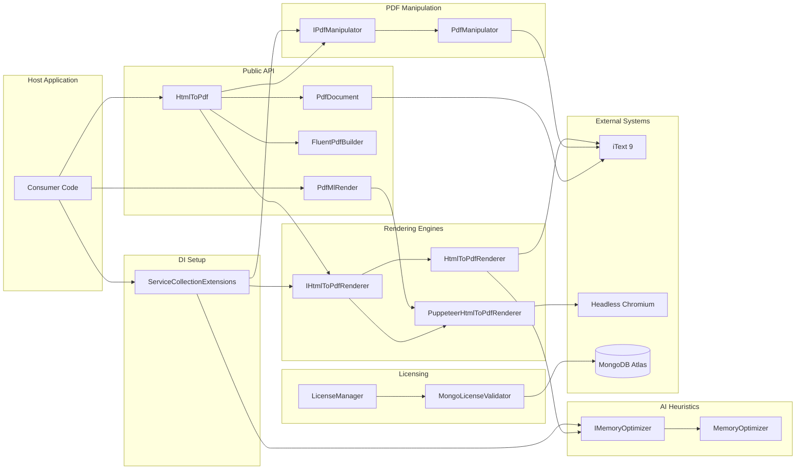
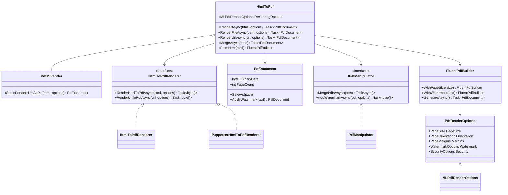
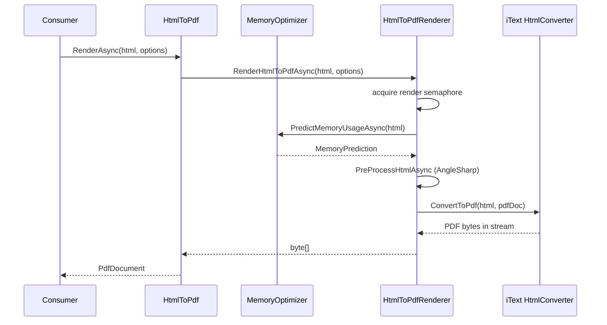
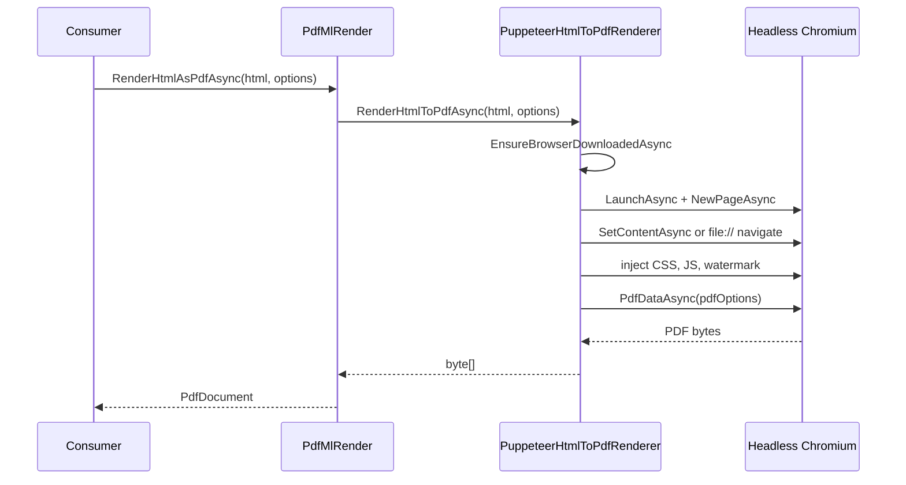
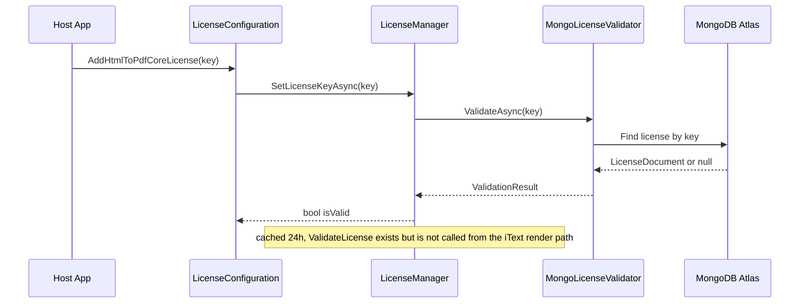
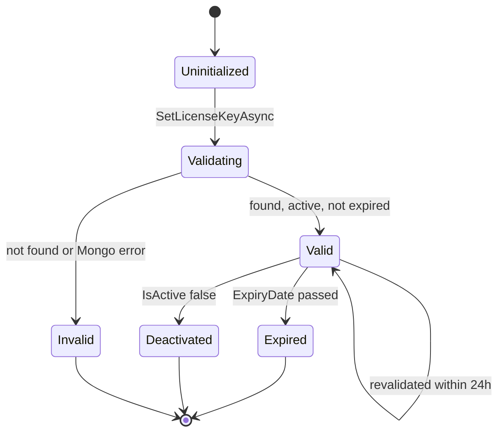

# Project analysis: SCRUM-29 - Analyze Project and Generate Diagram Definitions

_Generated by AI SprintFlow on 2026-10-21 from `RoyceLark/HtmlToPdfCore` at `ac5c802651`. No code was changed._

## Summary

HtmlToPdfCore (packaged as Pdf.ML) is a single-project .NET class library (net8.0/net9.0/net10.0) that converts HTML/URLs/files into PDFs, with two interchangeable rendering engines (an iText-9 engine and a PuppeteerSharp/Chromium engine), PDF post-processing (merge/split/watermark/encrypt/extract text), an AI-ish heuristic memory optimizer, and a license-gating subsystem backed by a hard-coded MongoDB Atlas connection string. There is no web host, controller or database for business data — the library is consumed by a host app via `HtmlToPdf`/`PdfMlRender` or DI (`AddHtmlToPdfCore`). The design favors a very wide, alias-heavy public API (parity with a commercial competitor, IronPDF) over internal simplicity, which shows up as duplicated option properties and two renderer implementations with overlapping responsibility. The most serious risks are the embedded MongoDB credentials in `LicenseManager.cs`, a disabled license check in the default (iText) render path, and the proprietary/MIT-license inconsistency in the metadata.

## Architecture

This is a class library, not a service: there is no HTTP entry point. Consumers either `new HtmlToPdf()` / `new PdfMlRender()` directly, or call `services.AddHtmlToPdfCore(...)` (Extensions/ServiceCollectionExtensions.cs:19) to register `IHtmlToPdfRenderer`, `IPdfManipulator` and optionally `IMemoryOptimizer` in DI.

The facade `HtmlToPdf` (HtmlToPdf.cs:28) holds one `IHtmlToPdfRenderer` and one `IPdfManipulator`, exposes render methods (`RenderAsync`, `RenderFileAsync`, `RenderUrlAsync`, `RenderToFileAsync`), PDF manipulation methods (`MergeAsync`, `SplitAsync`, `AddWatermarkAsync`, `EncryptAsync`, `ExtractTextAsync`) and a fluent builder (`FromHtml/FromFile/FromUrl` → `FluentPdfBuilder`, HtmlToPdf.cs:439-738). `PdfMlRender` (HtmlToPdf.cs:420) is a subclass that swaps in `PuppeteerHtmlToPdfRenderer` instead of the default `HtmlToPdfRenderer`, for 'IronPDF parity' (true Chromium rendering).

There are two independent render pipelines behind `IHtmlToPdfRenderer`:
- `HtmlToPdfRenderer` (Renderers/HtmlToPdfRenderer.cs) — default engine used by `HtmlToPdf()`. Uses AngleSharp to pre-process HTML (inject viewport meta/media style), then iText 9's `HtmlConverter.ConvertToPdf` plus custom iText event handlers for headers/footers/watermarks, pooled `MemoryStream`s (`ObjectPool`), a `SemaphoreSlim` gate sized to `Environment.ProcessorCount`, and an `HttpClient` for `RenderUrlToPdfAsync`.
- `PuppeteerHtmlToPdfRenderer` (Renderers/PuppeteerHtmlToPdfRenderer.cs) — downloads/launches headless Chromium via PuppeteerSharp, sets viewport/cookies/headers, writes HTML to a temp file for `file://` BaseUrls (to get around Chromium's same-origin restrictions, lines 372-397), injects CSS for font-scale/grayscale/custom CSS, runs user JavaScript, waits for `document.fonts.ready`, injects a watermark via a `
` script, then calls `page.PdfDataAsync`.

`PdfManipulator` (Services/PdfManipulator.cs) implements `IPdfManipulator` purely with iText: merge/split via `CopyPagesTo`, watermark via direct `PdfCanvas` drawing, AES-256 encryption via `WriterProperties.SetStandardEncryption`, text extraction via `PdfTextExtractor`. `PdfDocument` (HtmlToPdf.cs:743) is a thin byte[] wrapper with its own iText-based helper methods (Merge, InsertPage, RemovePage, ApplyWatermark, StampHTML/Image, Encrypt, ExtractAllText) — i.e. manipulation logic is duplicated between `PdfManipulator` and `PdfDocument` rather than `PdfDocument` delegating to `IPdfManipulator`.

`MemoryOptimizer` (AI/MemoryOptimizer.cs) is not ML at all — despite being named/packaged as 'AI/ML-powered' and depending on `Microsoft.ML`, it extracts simple HTML features (img/table/div/script counts, CSS length via regex) and applies hand-written heuristic thresholds to predict memory usage and pick a chunk/compression strategy. It is wired into `HtmlToPdfRenderer` only (not into the Puppeteer engine) and only logs a prediction — it doesn't change buffer sizes or chunking in the actual render path (lines 100-105 of Renderers/HtmlToPdfRenderer.cs).

Licensing is a separate, external-dependency subsystem: `LicenseManager` (static class, Licensing/LicenseManager.cs) validates license keys against a MongoDB Atlas cluster via `MongoLicenseValidator` (Licensing/MongoLicenseValidator.cs), caching the result for 24h. `LicenseConfiguration` (Licensing/LicenseConfiguration.cs) offers DI-friendly setup from `IConfiguration` or a literal key, printing console banners on success/failure. Critically, the actual license *enforcement* call inside the hot render path (`HtmlToPdfRenderer.RenderHtmlToPdfAsync`, lines 75-82) is commented out, so license validation currently has no effect on whether `RenderHtmlToPdfAsync` runs.

External systems/dependencies: iText 9 (+ pdfhtml, bouncy-castle adapter) for PDF generation/manipulation, PuppeteerSharp (downloads/launches a real Chromium binary) for the alternate engine, MongoDB Atlas for license data, AngleSharp/HtmlAgilityPack for HTML parsing, Microsoft.ML/ObjectPool/Configuration/Logging.Abstractions, SixLabors.ImageSharp and System.Drawing.Common (referenced but not obviously used in the files read). There is no application database for business data — MongoDB is used purely for licensing.

**Tech stack:** .NET 8/9/10 class library (C#, nullable enabled), iText 9 (itext, itext.pdfhtml, itext.commons, itext.bouncy-castle-adapter) for HTML→PDF and PDF manipulation, PuppeteerSharp 18 (headless Chromium) for the alternate 'true Chromium' render engine, MongoDB.Driver 2.25 against MongoDB Atlas for license storage/validation, AngleSharp + HtmlAgilityPack for HTML parsing/pre-processing, Microsoft.Extensions.* (DependencyInjection, Logging, Configuration, ObjectPool) for DI/logging/pooling, Microsoft.ML 3.0.1 (referenced; actual 'AI' code is hand-written heuristics, not a trained model), SixLabors.ImageSharp / System.Drawing.Common (image-related, referenced in csproj)

## Components

| Component | Where | Responsibility | Uses |
|---|---|---|---|
| HtmlToPdf / PdfMlRender facade | `HtmlToPdf.cs` | Public entry point: render HTML/file/URL to PDF, fluent builder, PDF manipulation delegation, option copying. | IHtmlToPdfRenderer, IPdfManipulator, MemoryOptimizer |
| HtmlToPdfRenderer (iText engine) | `Renderers/HtmlToPdfRenderer.cs` | Default rendering pipeline: AngleSharp pre-processing + iText HtmlConverter, custom header/footer/watermark event handlers, URL fetch via HttpClient. | IMemoryOptimizer, ObjectPool<MemoryStream> |
| PuppeteerHtmlToPdfRenderer (Chromium engine) | `Renderers/PuppeteerHtmlToPdfRenderer.cs` | Alternate rendering pipeline using headless Chromium for full CSS/JS fidelity ('IronPDF parity'). |  |
| PdfManipulator | `Services/PdfManipulator.cs` | Merge, split, watermark, encrypt and extract text from existing PDFs via iText. |  |
| PdfDocument | `HtmlToPdf.cs:743-988` | Byte[] wrapper around a rendered PDF with convenience methods (save, merge, insert/remove page, stamp, encrypt) — duplicates logic also present in PdfManipulator. |  |
| MemoryOptimizer | `AI/MemoryOptimizer.cs` | Heuristic (not ML) prediction of memory usage and optimization strategy from HTML feature counts. |  |
| LicenseManager / MongoLicenseValidator / LicenseConfiguration | `Licensing/` | Validate a license key against MongoDB, cache for 24h, expose DI setup helpers; currently not enforced in the default render path. | MongoDB Atlas |
| ServiceCollectionExtensions | `Extensions/ServiceCollectionExtensions.cs` | DI registration of renderer, manipulator and optional AI optimizer with configurable options. | HtmlToPdfRenderer, PdfManipulator, MemoryOptimizer |
| Models (PdfRenderOptions etc.) | `Models/PdfRenderOptions.cs` | Configuration data model for every render option, with many alias properties for API-parity with other libraries. |  |

## Diagrams

### HtmlToPdfCore component overview

_Architecture._ Shows the public facade, the two swappable render engines, PDF manipulation, the heuristic optimizer, and the separate licensing subsystem talking to MongoDB. Note the iText engine optionally uses the optimizer; Puppeteer engine does not.

### Core API types

_UML class diagram._ Public API surface: the HtmlToPdf/PdfMlRender facade, the fluent builder, the PdfDocument result wrapper and the two interfaces each implemented by the two renderer classes.

### RenderAsync with the default (iText) engine

_UML sequence diagram._ Shows the default render path: the facade delegates to the iText engine, which optionally consults the heuristic MemoryOptimizer (log only) before converting HTML to PDF with iText.

### RenderAsync with PdfMlRender (Chromium engine)

_UML sequence diagram._ Shows the alternate render path used by PdfMlRender: a real Chromium instance is launched per call, content is loaded (via file:// for local assets), CSS/JS/watermark are injected post-load, then a PDF is produced.

### License validation flow

_UML sequence diagram._ The licensing subsystem validates a key against MongoDB and caches the result; the diagram also notes that the render path does not currently call this check (commented out).

### License lifecycle (per cached LicenseInfo)

_UML state diagram._ Lifecycle of a license as tracked by LicenseManager's cached state, based on ExpiryDate and IsActive checks in ValidateLicense/ValidateAsync.

## Risks

- Hard-coded MongoDB Atlas connection string with embedded credentials in Licensing/LicenseManager.cs:15 — a secret committed to source, and the only gate for commercial licensing.
- License enforcement is commented out in the default engine's render path (Renderers/HtmlToPdfRenderer.cs:75-82), so `HtmlToPdf`/`HtmlToPdfRenderer` currently renders PDFs without checking any license, while `LicenseManager.ValidateLicense()` (referenced but not shown enforced elsewhere either) exists unused in that path.
- License metadata is self-contradictory: AssemblyInfo.cs declares 'PROPRIETARY AND CONFIDENTIAL' plus `AssemblyMetadata("License", "MIT- for now")`, and the csproj also sets `PackageLicenseExpression>MIT`, while LicenseManager implements paid-tier gating logic — unclear actual licensing model.
- Two independent, largely duplicated render engines (iText-based vs Puppeteer-based) and duplicated PDF-manipulation code (PdfManipulator service vs instance methods on PdfDocument) increase maintenance cost and risk of behavioral drift between the two.
- MemoryOptimizer is marketed as 'AI/ML-powered' (README, csproj Description, Microsoft.ML dependency) but is pure regex/heuristic code that only logs a prediction without changing actual allocation/streaming behavior in the render pipeline — a mismatch between documentation and implementation that will confuse reviewers/users.
- PuppeteerHtmlToPdfRenderer launches Chromium with `--no-sandbox --disable-web-security --allow-file-access-from-files` (lines 58-62) — appropriate for local file loading but a security-sensitive default if the library ever renders untrusted/remote HTML.
- `PuppeteerHtmlToPdfRenderer.RenderHtmlToPdfAsync` launches a new browser process per call (no pooling) and downloads the Chromium binary lazily on first use (`EnsureBrowserDownloadedAsync`), which can cause large first-call latency and resource usage under load; there's no limit/semaphore comparable to the iText engine's `_renderSemaphore`.
- Watermark text is interpolated directly into a JS template literal in `InjectWatermarkAsync` (PuppeteerHtmlToPdfRenderer.cs:307) with only `'` escaped — other characters (backtick, `${`) are not escaped, risking script injection if watermark text comes from untrusted input.

## Open questions

- Is the commented-out license check in HtmlToPdfRenderer.cs intentional (e.g. feature-flagged for this environment) or a regression that should be restored before any release?
- Should the MongoDB connection string move to configuration/secret storage, and should the exposed credentials be rotated?
- What is the real licensing model (MIT vs proprietary/paid) — the codebase currently asserts both?
- Is the long-term intent to keep both renderer engines, or should `PuppeteerHtmlToPdfRenderer` become the only engine (given it is described as the 'IronPDF parity' / true-fidelity path) with the iText engine deprecated, to reduce duplicated logic?
- Should `PdfDocument`'s manipulation methods be refactored to delegate to `IPdfManipulator` instead of duplicating iText code inline?
